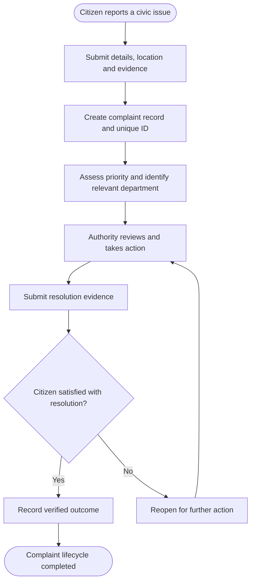
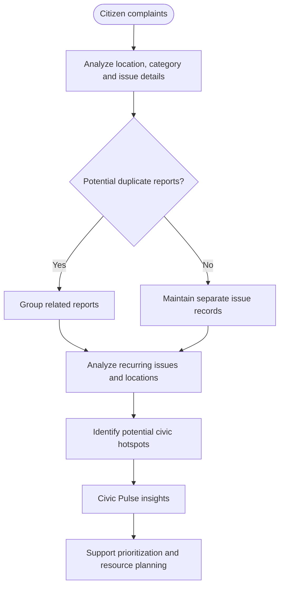

NIVARAN | CIVIC GRIEVANCE REDRESSAL & ACCOUNTABILITY PLATFORM

From reporting problems to verifying solutions.

Nivaran is a citizen-centric civic-tech platform designed to make public grievance redressal more transparent, trackable, and accountable. It aims to bridge the gap between citizens reporting civic issues and authorities taking action by connecting complaint tracking, structured prioritization, administrative visibility, and evidence-based resolution in one unified workflow.

LIVE PROTOTYPE: https://civic-trace.lovable.app

SOURCE CODE: https://github.com/aryakamakshi2289/nivaranforcitizens

---

THE PROBLEM

Civic issues such as damaged roads, overflowing garbage, broken streetlights, and neglected public infrastructure affect everyday life. However, reporting a problem does not always provide citizens with clarity about what happens next.

Common challenges include:

- Limited transparency: Citizens may struggle to track the progress of a complaint.
- Unclear accountability: Identifying the department responsible for resolving an issue can be difficult.
- Fragmented reporting: Multiple reports about the same problem can obscure the actual scale of the issue.
- Inefficient prioritization: Urgent concerns may require a more structured approach to assessment.
- Unverified resolution: A complaint marked as resolved does not necessarily establish that the original issue has been fixed.
- Lack of community-level insights: Recurring issues across locations can be difficult to identify when complaints are viewed individually.

Nivaran addresses these challenges by focusing on the complete grievance lifecycle, from initial reporting to documented action and citizen verification.

---

OUR SOLUTION

Nivaran proposes a structured civic grievance management system that connects citizen participation with administrative action and verifiable outcomes.

Instead of treating a complaint as a standalone submission, the platform is designed to make it traceable throughout its lifecycle. Citizens can follow complaint progress, while authorities gain a more organized view of reported issues, their priorities, and their resolution status.

---

KEY FEATURES

1. Evidence-Based Complaint Reporting

Citizens can report civic issues with relevant descriptions, location details, and supporting photographs. Unique complaint identifiers help make individual reports easier to reference and track.

2. Duplicate Detection and Issue Clustering

Related reports can be grouped to identify instances where multiple citizens are reporting the same underlying issue. This helps reduce fragmentation while preserving individual complaint records and highlighting the broader community impact.

3. Structured Issue Prioritization

Complaints can be assessed using factors such as severity, public safety, recurrence, and community impact. This approach is intended to help authorities identify urgent concerns and make more informed decisions about the order of attention.

4. Department-Based Routing

The platform is designed to direct complaints towards the relevant administrative department or workflow, helping clarify responsibility and organize follow-up action.

5. Authority Dashboard

A centralized administrative view helps organize complaints by status and priority, review pending issues, and monitor progress. It is intended to improve visibility and support more systematic complaint management.

6. Civic Pulse

Civic Pulse focuses on identifying recurring problems and geographic concentrations of civic complaints. By highlighting broader patterns rather than isolated reports, it can support data-informed decisions about maintenance and resource allocation.

7. Proof-Based Resolution

Resolution evidence, such as photographs documenting completed work, can be associated with a complaint. This provides a basis for comparing the reported problem with the claimed outcome instead of relying exclusively on a status update.

8. Citizen Verification and Reopening

Citizens can review resolution evidence and challenge an outcome when the issue remains unresolved. The proposed workflow supports reopening disputed complaints for further attention.

9. Chronological Complaint History

A structured history of complaint updates, administrative actions, evidence, and feedback can make the process easier to follow and review.

---

HOW NIVARAN WORKS

Nivaran follows a structured grievance-redressal process that connects citizens, civic authorities, and documented outcomes.

The workflow emphasizes that complaint management should extend beyond registration. It connects reporting with administrative action, resolution evidence, and citizen feedback. If a reported issue remains unresolved, the proposed process allows it to return for further attention.

---

DUPLICATE DETECTION AND CIVIC PULSE

Nivaran is designed to identify related reports and reveal broader patterns in civic issues. This helps distinguish individual complaints from shared underlying problems and supports more informed civic planning.

Duplicate grouping is intended to preserve individual complaint records while making shared issues easier to identify. Civic Pulse can use these patterns to highlight recurring concerns across locations, helping authorities understand where attention may be needed most.

---

WHAT MAKES NIVARAN DIFFERENT?

Nivaran's central differentiator is its emphasis on verifiable resolution rather than complaint registration alone.

- Complaint tracking improves visibility into the status of reported issues.
- Duplicate detection and issue clustering help organize repeated reports.
- Structured prioritization supports the assessment of urgency and community impact.
- Department-oriented routing helps clarify administrative responsibility.
- Proof-based resolution provides supporting evidence for claimed outcomes.
- Citizen verification and reopening allow disputed outcomes to receive further attention.
- Civic Pulse highlights recurring issues and geographic patterns.

The strength of the concept lies in bringing these capabilities together into one connected workflow rather than treating them as isolated features.

---

EXPECTED IMPACT

FOR CITIZENS

- Improved visibility into complaint progress.
- Easier access to complaint records.
- Greater transparency around claimed resolutions.
- An opportunity to challenge unsatisfactory outcomes.
- Better visibility into recurring local civic issues.

FOR CIVIC AUTHORITIES

- More structured grievance records.
- Better visibility into urgent and pending issues.
- Reduced fragmentation from repeated reports.
- Improved monitoring of complaint progress.
- More systematic documentation of action and resolution evidence.

FOR COMMUNITIES

- Greater transparency in civic grievance redressal.
- Improved identification of recurring infrastructure concerns.
- Potentially better-informed maintenance and resource allocation.
- A stronger feedback loop between citizens and public institutions.

These are intended benefits. Their actual impact would need to be evaluated through deployment and real-world performance data.

---

TECHNOLOGY AND IMPLEMENTATION

Nivaran is presented as an interactive civic-tech prototype with a user-facing interface intended to demonstrate its proposed grievance-management workflow.

Live demonstration: https://civic-trace.lovable.app

The project can serve as a foundation for a more comprehensive system incorporating:

- Secure authentication and role-based access.
- Persistent complaint records and evidence storage.
- Configurable department routing.
- Notifications and complaint status tracking.
- Geographic visualization and issue analytics.
- Duplicate identification and structured prioritization.
- Authorized integrations with existing civic grievance systems.

These are potential implementation directions and should not be interpreted as existing capabilities unless they are supported by the current codebase.

The technology stack should reflect the frameworks, libraries, databases, and services actually used in the implementation.

---

FUTURE SCOPE

Potential future enhancements include:

- Multilingual and accessibility-focused complaint reporting.
- Automated notifications and response-time monitoring.
- Improved image-based issue classification.
- Data-driven duplicate detection.
- Geographic analysis of recurring civic concerns.
- Integration with authorized municipal systems.
- Performance metrics for response times, resolution evidence, citizen verification, and reopened complaints.
- Pilot deployment in a defined locality to evaluate usability and effectiveness.

A phased approach would allow the platform to be tested and refined before expansion to additional departments or locations.

---

PROJECT OBJECTIVE

Nivaran aims to make civic grievance redressal more transparent, traceable, and accountable by creating a structured connection between citizens, public authorities, and documented outcomes.

The objective is not merely to digitize complaint submission, but to encourage a process in which responsibility can be followed, action can be documented, and outcomes can be questioned when necessary.

---

PROJECT INFORMATION

Project Name: Nivaran

Domain: Civic Technology, GovTech, Public Grievance Redressal

Focus Areas: Transparency, Accountability, Complaint Tracking, Evidence-Based Resolution, Civic Data Insights

Repository: https://github.com/aryakamakshi2289/nivaranforcitizens

Live Prototype: https://civic-trace.lovable.app

---

PROJECT STATUS

Nivaran is a prototype-stage project demonstrating a proposed approach to civic grievance management. Feature availability may vary according to the current implementation. Live government integration, operational municipal workflows, and real-world resolution outcomes should not be assumed.

---

NIVARAN — FOR WHAT NEEDS TO CHANGE.

Building a more transparent path from civic concerns to accountable action.
